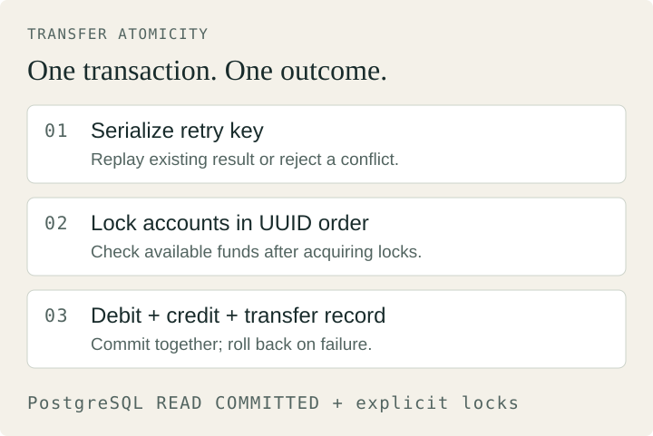
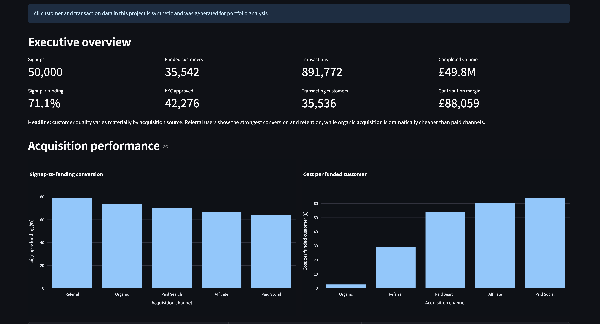

# Neobank

**Transfers that hold together. Analysis that questions the headline.**

Two separate components: a FastAPI/PostgreSQL transaction simulator and a Python/SQL growth-analytics pipeline over **891,772 synthetic transactions**. API activity does not feed the analytics dataset.

[Transaction design](docs/banking-api.md) · [Concurrency tests](tests/api/test_transactions.py) · [Analytics findings](docs/analytics.md) · [Live dashboard](https://neobank-growth-analytics-hajar.streamlit.app/)

## The transaction boundary



**Retries have an identity.** A transaction-scoped advisory lock serializes matching keys before checking the stored result. The same key and payload replay the original transfer; a changed payload returns a conflict.

**Concurrent spending has a boundary.** Both account rows are locked in a consistent UUID order before checking funds. Debit, credit and the transfer record commit together. Tests include simultaneous spending, opposite-direction transfers and a forced failure after the balance updates.

[Read the implementation](banking_api/service.py) · [37-test verification record](docs/engineering-verification.md) · [Database-only index measurements](docs/engineering-verification.md#query-plan-measurement)

### Try the API locally

Requires Docker Desktop. From the repository root:

```sh
python3 scripts/init-api-env.py
docker compose --env-file .env.api -f compose.api.yml up -d --build
docker compose --env-file .env.api -f compose.api.yml exec banking-api python -m banking_api.demo
```

Open **http://localhost:8000/docs**. The demo creates accounts, transfers synthetic funds and verifies a retry. [Manual examples, tests and shutdown](docs/banking-api.md).

## The analytics decision



A simulated **£10 activation bonus** increased activation by **4.09 percentage points**, but the observed economics did not support launching it. Break-even required about **£178.72** of contribution margin per incremental activation, against **£2.47** observed in the short window.

The pipeline also covers channel conversion, fully observed retention cohorts and transaction economics. FX engagement is an association, not a demonstrated causal effect.

[Full findings, assumptions and exact reproduction](docs/analytics.md) · [Experiment analysis](src/experiment_analysis.py) · [SQL](sql/) · [Analytics tests](tests/analytics/)

## Boundaries worth knowing

All funds and customer data are synthetic. The local API has no authentication or account ownership enforcement and is not a production ledger or payment service. Its database and ports stay local. An optional isolated public-demo configuration is documented separately in the [deployment guide](docs/public-demo.md).

Query benchmarks time PostgreSQL execution, not HTTP latency. Analytics conclusions describe the generated dataset and observation window, not real banking customers.

Built by **Hajar Mrifag** with Python, FastAPI, PostgreSQL, Streamlit and Docker.
